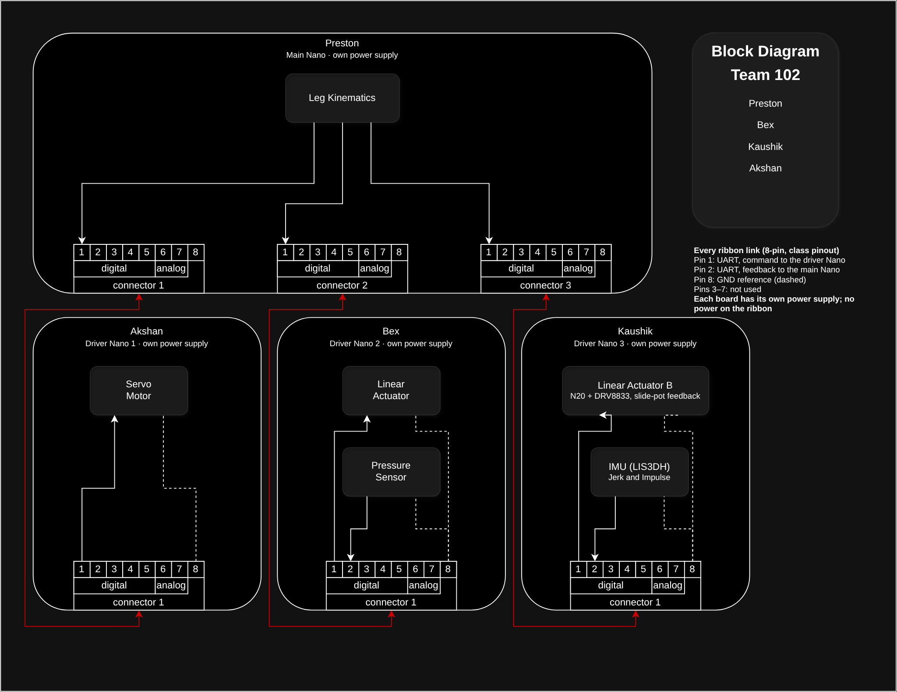

# Block Diagram, Process Diagram, and Message Structure

This page explains the proposed hardware organization, software processes, and communication between the four PIC18F57Q43 Curiosity Nano microcontrollers used to control one robotic spider leg.

The team is responsible for designing and building one leg, which could eventually become part of a six-legged walking robot.

## Table of Contents

1. [Team Block Diagram](#team-block-diagram)
2. [Subsystem Responsibilities](#subsystem-responsibilities)
3. [Process Diagram](#process-diagram)
4. [Communication and Message Structure](#communication-and-message-structure)
5. [Sensors and Actuators](#sensors-and-actuators)
6. [Safety and Error Handling](#safety-and-error-handling)

---

## Team Block Diagram

The system uses four Curiosity Nano microcontrollers. One Nano handles the main calculations and coordinates the other three Nanos, which control individual motors, actuators, and sensors.

### Original Team 102 Block Diagram

*Figure 1: Original Team 102 block diagram showing the main controller and three driver controllers.*

The main Nano acts as the central controller. The other Nanos receive movement commands and return sensor information.

The team plans to use 8-pin ribbon cable connectors between the controllers and their assigned components.

---

## Subsystem Responsibilities

Each team member is responsible for a different portion of the robotic leg.

| Team Member | Controller | Responsibilities |
|---|---|---|
| Preston | Main Nano | Kinematics, IR remote, RGB LED, communication |
| Akshan | Driver Nano 1 | Servo motor and proposed display |
| Bex | Driver Nano 2 | Linear actuator A, pressure sensor, limit switches, status LED |
| Kaushik | Driver Nano 3 | Linear actuator B, IMU, limit switches, sensor feedback |

### Main Nano — Preston

The main controller is responsible for:

- Receiving commands from the IR remote
- Calculating the desired leg position
- Performing kinematics calculations
- Sending movement commands to the driver Nanos
- Receiving sensor feedback
- Monitoring system status
- Controlling the RGB status LED
- Handling communication faults

### Driver Nano 1 — Akshan

This controller is responsible for:

- Receiving servo position commands
- Controlling the servo motor
- Reporting motor status
- Operating the proposed diagnostic display

The final servo model and display are still being selected.

### Driver Nano 2 — Bex

This controller is responsible for:

- Receiving movement commands
- Controlling linear actuator A
- Reading the pressure sensor
- Monitoring assigned limit switches
- Controlling a local status LED
- Sending sensor information to the main Nano

### Driver Nano 3 — Kaushik

This controller is responsible for:

- Receiving movement commands
- Controlling linear actuator B
- Reading the IMU
- Monitoring assigned limit switches
- Sending sensor information to the main Nano

---

## Process Diagram

The proposed process begins when the system is powered on.

The main Nano initializes its hardware and communication, reads user input, calculates the required movement, and sends commands to the driver Nanos.

### Main Controller Process

1. Start the system.
2. Initialize the microcontroller.
3. Initialize communication with the driver Nanos.
4. Read commands from the IR remote.
5. Determine the desired leg position.
6. Calculate the required joint positions.
7. Send movement commands to the driver Nanos.
8. Receive sensor feedback.
9. Check for faults and movement limits.
10. Update the RGB status LED.
11. Repeat the process.

### Driver Controller Process

1. Initialize the assigned hardware.
2. Wait for a command from the main Nano.
3. Check the command against movement limits.
4. Control the assigned motor or actuator.
5. Read the connected sensors.
6. Check the limit switches.
7. Send feedback to the main Nano.
8. Repeat until the system is stopped.

The driver Nanos are intended to operate independently after receiving valid commands, without waiting unnecessarily for the other drivers.

---

## Communication and Message Structure

The team currently plans to use UART communication between the Nanos.

UART allows the microcontrollers to send movement commands and return sensor information using serial communication.

The exact wiring arrangement, pin assignments, and baud rate have not been finalized.

### Communication Overview

| Sender | Receiver | Information |
|---|---|---|
| Main Nano | Driver Nano 1 | Servo position commands |
| Main Nano | Driver Nano 2 | Linear actuator A commands |
| Main Nano | Driver Nano 3 | Linear actuator B commands |
| Driver Nano 1 | Main Nano | Servo status |
| Driver Nano 2 | Main Nano | Pressure and actuator feedback |
| Driver Nano 3 | Main Nano | IMU and actuator feedback |

### Proposed Message Structure

The software will need a consistent message format so each Nano can identify commands and sensor readings.

| Field | Purpose |
|---|---|
| Destination | Identifies the receiving controller |
| Command | Identifies the requested action |
| Value | Contains position, speed, or sensor data |
| Status | Indicates normal operation or a fault |

### Proposed Commands

| Command | Description |
|---|---|
| MOVE | Request movement to a position |
| SPEED | Change the requested movement speed |
| STOP | Stop commanded movement |
| STATUS | Request controller status |
| SENSOR | Send or request sensor information |
| ERROR | Report a detected fault |

These command names are proposed examples. The final message format will be determined during programming and testing.

### Ribbon Cable Connections

The team has discussed using 8-pin ribbon cables for connections between controllers and hardware.

The proposed connector organization includes:

| Pin | Proposed Use |
|---|---|
| 1 | Digital signal or communication |
| 2 | Digital signal or communication |
| 3 | Digital signal |
| 4 | Digital signal |
| 5 | Digital signal |
| 6 | Analog signal |
| 7 | Analog signal |
| 8 | Ground |

This is a proposed layout, not the final wiring schematic. The team will confirm the exact signals and electrical compatibility before connecting the boards.

---

## Sensors and Actuators

The robotic leg will use multiple components to control movement and monitor its position.

### Actuators

| Component | Purpose | Controller |
|---|---|---|
| Servo motor | Controls one joint | Akshan |
| Linear actuator A | Controls one joint | Bex |
| Linear actuator B | Controls one joint | Kaushik |

The final actuator models and motor drivers have not been selected.

### Sensors

| Component | Purpose |
|---|---|
| IR sensor | Receives commands from a remote |
| Pressure sensor | Detects contact or applied pressure |
| IMU | Measures orientation and movement |
| Limit switches | Detect joint movement limits |

### Status Indicators

The system will use LEDs to provide visual information about its operation.

| Indicator | Proposed Purpose |
|---|---|
| RGB LED | Displays overall system status |
| Local status LEDs | Display individual controller or joint status |

The final LED colors and meanings will be assigned during programming.

---

## Safety and Error Handling

Safety is important because the robotic leg contains moving joints and actuators.

The software must prevent commands from causing movement beyond the allowed joint range.

### Limit Switches

The current plan includes two limit switches for each of the three joints.

These switches will help identify when a joint reaches either end of its allowed movement.

If a limit switch is activated, the software should stop movement farther into that limit.

### Communication Loss

If a driver Nano loses communication with the main Nano, the affected actuator should stop safely.

The controller should report the communication fault when communication becomes available again.

### Invalid Movement Commands

The software should reject commands that request movement outside the allowed range.

### Fault Response Table

| Condition | Proposed Response |
|---|---|
| Joint limit reached | Stop movement farther into the limit |
| Communication lost | Stop the affected actuator |
| Invalid command | Reject the command |
| Sensor error | Report a fault |
| Startup | Keep motors stopped until initialization finishes |
| Stop command | Stop commanded movement |

---

## Development Status

The block diagram and communication structure represent the team's current proposed design.

The following items still need to be finalized:

- Servo and linear actuator models
- Motor driver circuits
- UART pin assignments and baud rate
- Ribbon cable pinout
- Power distribution
- Diagnostic display
- Final sensor connections
- Communication message format
- Safety testing

The diagrams and tables will be updated as the team completes the hardware and software design.
