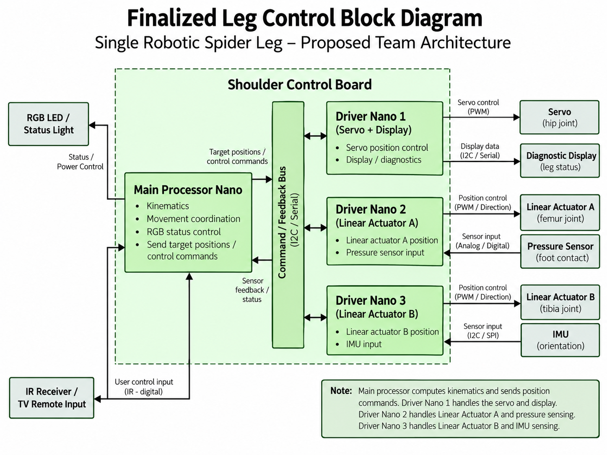
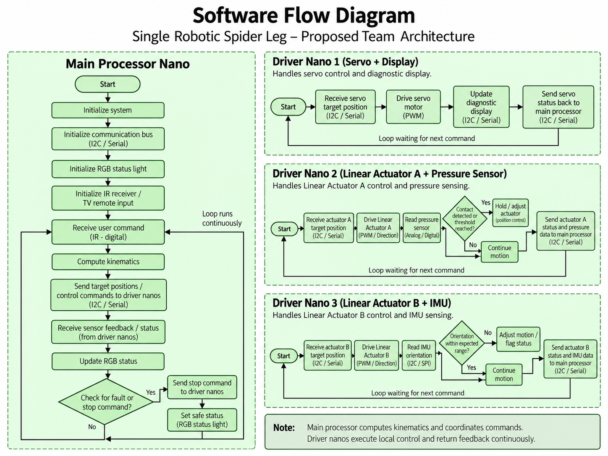

---
title: Software Proposal
---

# Software Proposal

## Table of Contents

1. [Introduction](#introduction)
2. [Software Objectives](#software-objectives)
3. [Software Architecture Diagram](#software-architecture-diagram)
4. [Software Flow Diagram](#software-flow-diagram)
5. [Subsystem Responsibilities](#subsystem-responsibilities)
6. [Main Controller - Preston](#main-controller---preston)
7. [Servo Controller - Akshan](#servo-controller---akshan)
8. [Linear Actuator A - Bex](#linear-actuator-a---bex)
9. [Linear Actuator B - Kaushik](#linear-actuator-b---kaushik)
10. [UART Communication](#uart-communication)
11. [Sensors and Indicators](#sensors-and-indicators)
12. [Safety and Fault Handling](#safety-and-fault-handling)
13. [Software Testing Plan](#software-testing-plan)
14. [Future Work](#future-work)

---

## Introduction

Our team is developing the software for one robotic spider leg that could eventually be used as part of a six-legged robot.

The leg will use four PIC18F57Q43 Curiosity Nano microcontrollers. Each teammate is responsible for programming a different part of the system.

Instead of having one Nano control everything, we are dividing the work between a main controller and three driver controllers.

Preston's Nano will calculate the leg kinematics and coordinate movement. The other three Nanos will control their assigned motors, actuators, and sensors.

Our goal is to make the software modular so each teammate can develop and test their part before combining everything into one working robotic leg.

[Back to Table of Contents](#table-of-contents)

---

## Software Objectives

The main goals of our software are:

1. Control three joints of one robotic leg.
2. Calculate the joint positions required for movement.
3. Receive user commands through an IR remote.
4. Communicate between four Nanos using UART.
5. Control one servo motor and two linear actuators.
6. Read pressure sensor and IMU information.
7. Monitor limit switches at each joint.
8. Use indicator lights to display system and joint status.
9. Stop commanded movement when a fault occurs.
10. Allow each controller to be programmed and tested separately.

[Back to Table of Contents](#table-of-contents)

---

## Software Architecture Diagram

The following block diagram shows our proposed software and hardware arrangement.

Preston's Nano is the main processor. It calculates the required joint positions and sends commands to the three driver Nanos.

Each driver Nano controls its assigned hardware and returns feedback to the main controller.

**Figure 1:** Proposed leg control block diagram showing the four Nanos, actuators, sensors, and main controller.

### Architecture Overview

| Controller | Teammate | Responsibilities |
|---|---|---|
| Main Processor Nano | Preston Potts | Kinematics, IR remote, movement coordination, and global status |
| Driver Nano 1 | Akshan Bhelkar | Servo motor and proposed diagnostic display |
| Driver Nano 2 | Bex Baker | Linear Actuator A and pressure sensor |
| Driver Nano 3 | Kaushik Gunasekaren | Linear Actuator B and IMU |

The current communication plan uses UART between the Nanos.

**Note:** The diagram was created during our earlier design planning and labels some connections as I2C/Serial. Our current plan is to use UART for communication between the Nanos. The final hardware connections still need to be verified.

[Back to Table of Contents](#table-of-contents)

---

## Software Flow Diagram

The software flow diagram shows the proposed operating process for all four Nanos.

The main controller receives commands, calculates joint positions, sends movement instructions, and checks feedback.

The three driver Nanos receive commands, operate their assigned hardware, read sensor information, and report their status.

**Figure 2:** Proposed software flow diagram showing the main processor and three driver controllers.

### Main Software Process

1. Initialize the main Nano.
2. Initialize communication and indicator lights.
3. Initialize the IR receiver.
4. Wait for a command from the remote.
5. Read the requested movement.
6. Calculate the required joint positions.
7. Send commands to the driver Nanos.
8. Receive sensor and joint feedback.
9. Check for faults or stop commands.
10. Update the system status indicator.
11. Repeat the process.

### Driver Nano Process

1. Initialize the Nano.
2. Initialize UART communication.
3. Initialize the assigned actuator and sensors.
4. Wait for a movement command.
5. Check the command and joint limits.
6. Operate the assigned actuator.
7. Read sensor information.
8. Check for faults.
9. Send feedback to the main Nano.
10. Repeat the process.

Each driver Nano will run its own control loop while communicating with Preston's main controller.

[Back to Table of Contents](#table-of-contents)

---

## Subsystem Responsibilities

Our software is divided into four subsystems.

Each teammate will be responsible for programming, testing, and documenting their assigned controller.

| Function | Responsible Teammate |
|---|---|
| IR remote input | Preston |
| Leg kinematics | Preston |
| Movement coordination | Preston |
| Global status indicator | Preston |
| Servo motor control | Akshan |
| Diagnostic display | Akshan - TBD |
| Linear Actuator A | Bex |
| Pressure sensor | Bex |
| Linear Actuator B | Kaushik |
| IMU | Kaushik |
| Limit switch monitoring | Each joint controller |
| UART communication | All four controllers |
| Fault handling | All four controllers |

[Back to Table of Contents](#table-of-contents)

---

## Main Controller - Preston

Preston's Nano will act as the main processor for the robotic leg.

It will receive input from the IR remote, calculate the required joint positions, and send movement commands to the other controllers.

### Planned Functions

- Initialize the system.
- Read IR remote commands.
- Calculate leg kinematics.
- Send movement commands.
- Receive sensor feedback.
- Monitor communication.
- Update the global indicator.
- Handle faults and stop commands.

The main controller will coordinate movement but will not directly operate every actuator.

[Back to Table of Contents](#table-of-contents)

---

## Servo Controller - Akshan

Akshan's Nano will control the servo motor assigned to one of the leg joints.

It will receive target position commands from Preston's Nano and generate the appropriate servo control signal.

### Planned Functions

1. Initialize the servo interface.
2. Initialize UART communication.
3. Monitor the joint limit switches.
4. Receive the target position.
5. Check whether the movement is allowed.
6. Control the servo.
7. Monitor joint status.
8. Send feedback to Preston's Nano.

Akshan's Nano is also assigned the proposed diagnostic display.

The display model, wiring, and software are still TBD.

[Back to Table of Contents](#table-of-contents)

---

## Linear Actuator A - Bex

Bex's Nano will control Linear Actuator A and monitor the pressure sensor.

It will receive movement commands from Preston's Nano and operate the actuator through its motor driver.

### Planned Functions

1. Initialize UART communication.
2. Initialize the motor driver interface.
3. Initialize the pressure sensor.
4. Initialize two limit switches.
5. Wait for a movement command.
6. Check whether movement is allowed.
7. Extend, retract, or stop the actuator.
8. Read the pressure sensor.
9. Monitor the limit switches.
10. Send sensor and joint status information to Preston's Nano.
11. Update the joint indicator.

### Inputs and Outputs

| Type | Component | Purpose |
|---|---|---|
| Input | UART RX | Receive movement commands |
| Input | Pressure sensor | Detect pressure or contact |
| Input | Limit switch 1 | Detect one travel limit |
| Input | Limit switch 2 | Detect the opposite travel limit |
| Output | Motor driver signals | Control actuator movement |
| Output | UART TX | Send feedback |
| Output | White LED | Display joint status |

The final actuator model, motor driver, and pin assignments are still TBD.

[Back to Table of Contents](#table-of-contents)

---

## Linear Actuator B - Kaushik

Kaushik's Nano will control Linear Actuator B and collect information from the IMU.

The IMU will provide measurements that can be used to monitor the movement and orientation of the robotic leg.

### Planned Functions

1. Initialize UART communication.
2. Initialize the motor driver interface.
3. Initialize the IMU.
4. Initialize two limit switches.
5. Wait for a movement command.
6. Check the joint limits.
7. Control Linear Actuator B.
8. Read IMU measurements.
9. Monitor for faults.
10. Send feedback to Preston's Nano.
11. Update the joint indicator.

The final actuator model, IMU, motor driver, and pin assignments are still TBD.

[Back to Table of Contents](#table-of-contents)

---

## UART Communication

Our current plan is to use UART communication between the four Nanos.

Preston's main Nano will communicate directly with each driver Nano through a separate connection.

### Communication Layout

| Connection | Commands Sent | Feedback Returned |
|---|---|---|
| Preston to Akshan | Servo target position | Servo and joint status |
| Preston to Bex | Actuator A movement command | Pressure and limit information |
| Preston to Kaushik | Actuator B movement command | IMU and limit information |

Each UART connection requires:

- TX (transmit)
- RX (receive)
- Common ground

The TX signal from one Nano connects to the RX signal on the other Nano.

### Proposed Commands

| Command | Purpose |
|---|---|
| MOVE | Request movement |
| STOP | Stop commanded movement |
| STATUS | Request controller status |
| POSITION | Report position information |
| SENSOR | Report sensor measurements |
| LIMIT | Report an active limit switch |
| FAULT | Report a detected fault |
| READY | Indicate that a controller is ready |

The final message format, baud rate, pin assignments, and error-checking method have not yet been finalized.

[Back to Table of Contents](#table-of-contents)

---

## Sensors and Indicators

Our software will use several sensors and indicator lights.

### IR Receiver

The IR receiver will connect to Preston's Nano.

It will receive commands from a compatible TV remote and allow the user to control the robotic leg.

### Pressure Sensor

The pressure sensor will connect to Bex's Nano.

It will provide information about pressure or contact at the leg.

### IMU

The IMU will connect to Kaushik's Nano.

It will provide measurements related to motion and orientation.

### Limit Switches

Our current plan includes two limit switches for each joint.

Since the leg has three joints, this gives us six planned limit switches.

The switches will help prevent the joints from moving beyond their allowed range.

### Indicator Lights

| LED Color | Purpose |
|---|---|
| Yellow | Power indicator |
| Green | Board power indicator |
| Blue | Global status indicator |
| White | Joint status indicator |

The exact software behavior for the blue and white indicators is still being determined.

[Back to Table of Contents](#table-of-contents)

---

## Safety and Fault Handling

Our software will include checks to reduce the risk of uncontrolled movement and hardware damage.

### Joint Limits

Each joint controller will monitor its assigned limit switches.

When a travel limit is reached, the controller should prevent further movement in the restricted direction.

### Communication Loss

If a controller stops receiving valid communication for longer than an approved timeout, it should enter a safe state.

The exact timeout and stopping behavior will be selected and tested.

### Invalid Commands

Each controller should check incoming commands before operating its hardware.

Commands outside the allowed operating range should be rejected or limited.

### Fault Reporting

Possible faults include:

- Communication loss
- Invalid movement command
- Joint limit reached
- Sensor failure
- Motor stall or overload
- Position feedback failure

Each driver Nano should report detected faults to Preston's main controller.

[Back to Table of Contents](#table-of-contents)

---

## Software Testing Plan

We plan to test each Nano individually before connecting the complete system.

### Individual Testing

| Controller | Planned Tests |
|---|---|
| Preston | IR input, kinematics, and UART communication |
| Akshan | Servo control, limit switches, and feedback |
| Bex | Linear actuator control, pressure sensor, limit switches, and feedback |
| Kaushik | Linear actuator control, IMU, limit switches, and feedback |

### Communication Testing

After individual testing, we will verify that:

1. Commands are received correctly.
2. Each Nano responds to the correct command.
3. Sensor information is returned to the main Nano.
4. Invalid commands are handled correctly.
5. Communication loss causes the expected safe behavior.

### Full System Testing

Once the individual subsystems are working, we will combine all four Nanos.

We will test the complete process from receiving an IR remote command to calculating joint positions, moving the actuators, and receiving feedback.

We will also verify the limit switches, indicator lights, and fault handling.

These tests are planned and have not yet been reported as completed.

[Back to Table of Contents](#table-of-contents)

---

## Future Work

Our next steps are:

1. Finalize the servo and linear actuator models.
2. Select the motor drivers.
3. Confirm the pressure sensor and IMU models.
4. Finalize UART pin assignments.
5. Define the UART message format.
6. Complete the electrical schematics.
7. Finalize the diagnostic display.
8. Develop and test each Nano's software.
9. Combine the four controllers.
10. Test the complete robotic leg.

Our goal is to create a working software system where each Nano can perform its assigned task while communicating with the main controller.

[Back to Table of Contents](#table-of-contents)

