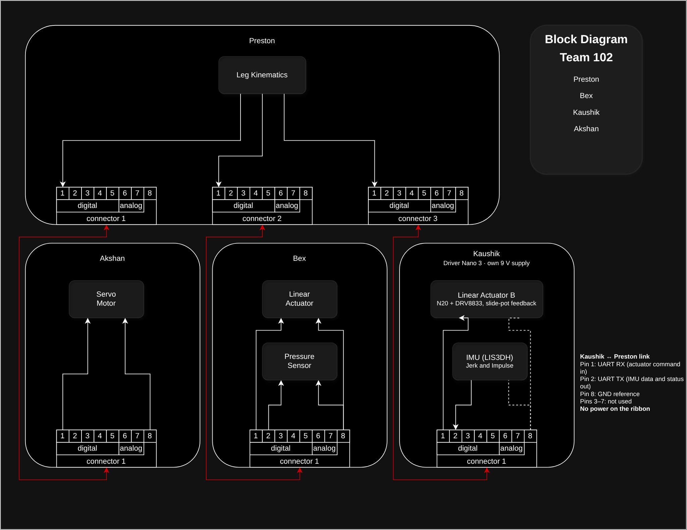

# RAS 304 — Team 102

**Robotic Spider Leg Project**

**Arizona State University | Fall 2026**

**External Design Review — October 29, 2026**

**Instructor:** Professor Vivek Thangavelu

---

## Meet Team 102

| Team Member | Project Responsibility |
|---|---|
| Preston Potts | Main Controller and Kinematics |
| Akshan Bhelkar | Driver Nano 1 — Servo and Display |
| Bex Baker | Driver Nano 2 — Linear Actuator and Sensors |
| Kaushik Gunasekaren | Driver Nano 3 — Linear Actuator and Sensors |

## Project Overview

Team 102 is designing and developing one functional robotic leg for a six-legged spider robot. Our goal is to create a modular system that can be understood, modified, and used by other robotics enthusiasts. The design combines mechanical movement, embedded electronics, and sensor feedback to control three joints. Four PIC18F57Q43 Curiosity Nano development boards divide the responsibilities between movement calculations, actuator control, and sensor monitoring. The main controller coordinates joint movement, while the driver controllers manage their assigned hardware. UART is the team's selected communication method. The current design includes two linear actuators, a servo motor, limit switches, pressure sensing, and an IMU.

## Project Goals

Our main objectives are to:

- Design and build one functional robotic leg.
- Control movement across three joints.
- Use multiple microcontrollers to divide system responsibilities.
- Coordinate the controllers using UART communication.
- Monitor movement limits and sensor feedback.
- Provide system and joint status information.
- Develop a modular design that can be modified or expanded.
- Test the completed subsystems before full integration.

## System Design

The robotic leg uses four PIC18F57Q43 Curiosity Nano development boards.

| Controller | Main Function |
|---|---|
| Main Nano | Kinematics, movement commands, IR remote, RGB status |
| Driver Nano 1 | Servo motor and diagnostic display |
| Driver Nano 2 | Linear actuator A, pressure sensor, limit switches |
| Driver Nano 3 | Linear actuator B, IMU, limit switches |

The main controller calculates the required joint movement and sends commands to the driver controllers. Each driver processes its assigned commands and returns status information.

### Team Block Diagram

*Figure 1. Team 102 proposed hardware architecture.*

## Design Approach

The team explored several mechanical and electrical concepts before developing the current design.

The initial concepts included rotary servo actuation, electric linear actuation, and a linear-actuator design with a gecko-inspired end effector.

The current design combines features from the concepts, including linear actuators, servo control, sensor feedback, and mechanical limit monitoring.

The team also chose a distributed control architecture so each subsystem could be developed and tested separately.

## Software Approach

The main controller handles kinematics and sends movement commands through UART.

The driver controllers are responsible for controlling the assigned actuators, reading sensors, and monitoring operating conditions.

The proposed software includes communication monitoring and fault handling to stop commanded movement when a limit or communication failure is detected.

### Software Flow Diagram

*Figure 2. Proposed software operation.*

## Project Documentation

The following pages contain the team's design work and engineering decisions.

| Report Section | Description |
|---|---|
| [User Needs and Benchmarking](03-User-Needs-and%20Benchmarking.md) | Stakeholders, user needs, and benchmarking |
| [Product Requirements](04-Product-Requirements.md) | Engineering requirements and specifications |
| [Design Ideation](05-design-ideation.md) | Brainstorming, design concepts, and selection reasoning |
| [Team Block Diagram](06-team-block-diagram.md) | Hardware architecture and controller responsibilities |
| [Software Proposal](07-Software%20Proposal.md) | Software structure, communication, and fault handling |

## Individual Datasheets

Each team member is responsible for documenting their assigned subsystem.

| Team Member | Individual Datasheet |
|---|---|
| Preston Potts | [Preston's Datasheet](https://r0gue12.github.io/papotts_RAS304_Fall26/) |
| Akshan Bhelkar | [Akshan's Datasheet](https://akshan2.github.io/abhelkar_RAS304_F26/) |
| Bex Baker | [Bex's Datasheet](https://rab2254-art.github.io/rbaker54_RAS304_F26/) |
| Kaushik Gunasekaren | [Kaushik's Datasheet](https://kaushikgunasekaren.github.io/kgunase7_RAS304_F26/) |

## External Design Review

**Review Date:** October 29, 2026

The purpose of this design review is to present the team's current design, explain the engineering decisions behind the hardware and software architecture, and receive feedback before final implementation.

### Current Progress

- Initial project objectives and requirements documented.
- Design concepts developed and compared.
- Four-controller architecture established.
- UART selected as the communication method.
- Initial block diagrams and software flow prepared.
- Individual subsystem schematics under development.

### Remaining Work

- Finalize actuator and motor-driver selections.
- Complete electrical schematics.
- Verify power requirements.
- Finalize UART message structure and wiring.
- Complete software implementation.
- Test individual subsystems.
- Integrate and verify the robotic leg.

## Conclusion

Team 102's current design provides a foundation for a modular robotic spider leg. The next stage of development focuses on completing the electrical and software designs, testing the individual controllers, and integrating the subsystems into one functioning leg.

